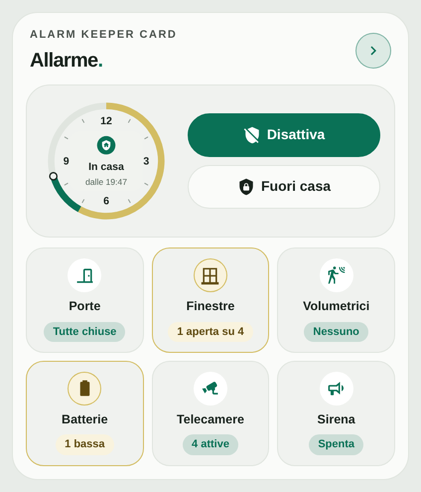
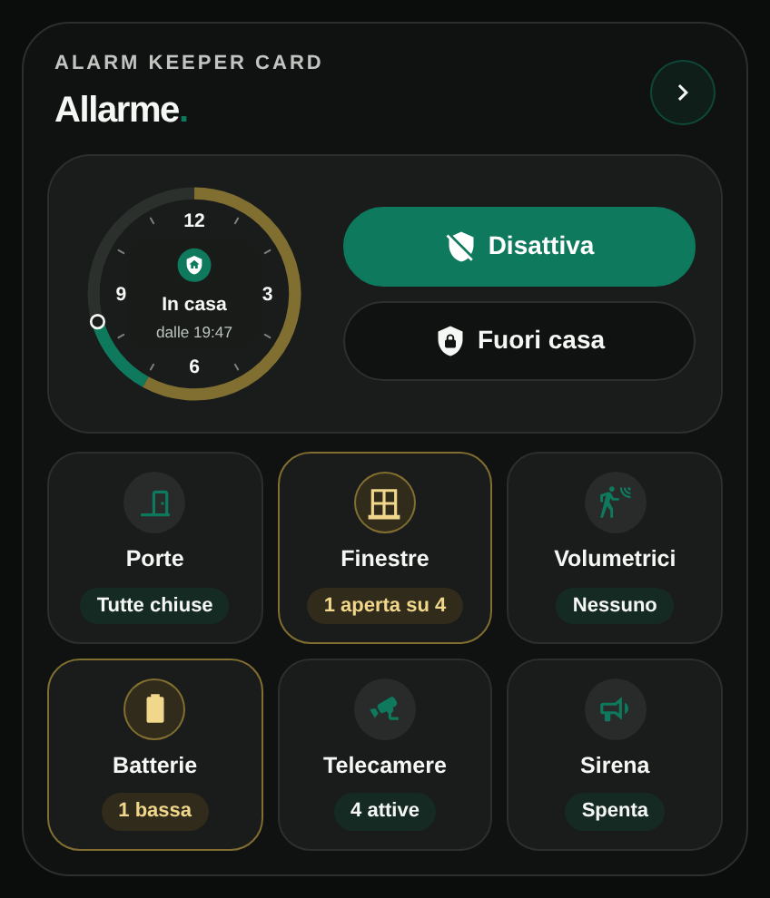
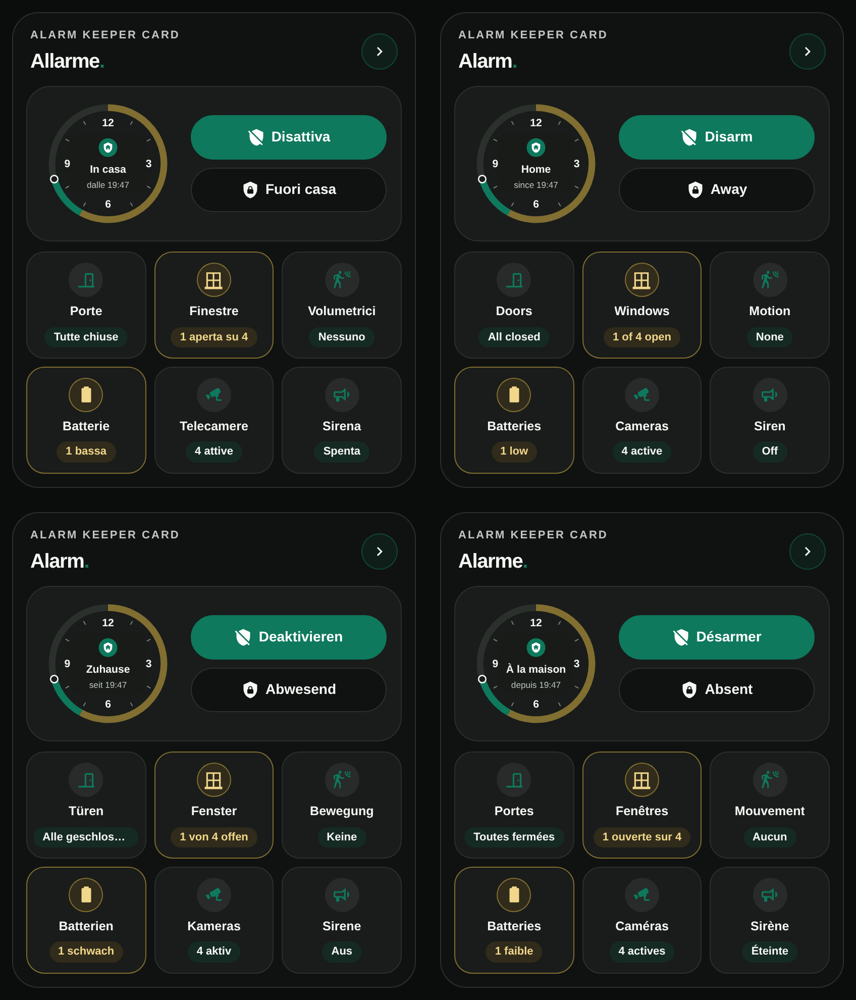

# Alarm Keeper Card

## Overview

**Alarm Keeper Card** is a custom alarm card for Home Assistant, designed with a minimalist, responsive interface inspired by the Edera Light and Dark visual styles.

A 12-hour clock shows how long the alarm has been armed today: green while armed at home, blue while armed away and yellow while not armed. Below it you can arm and disarm the alarm, and a compact grid summarises doors, windows, motion sensors, batteries, cameras and the siren. The details popup lists every entity by room and shows what needs attention first.

The card is modular. Doors, windows, motion sensors, tamper sensors, batteries, the base station, the siren, cameras, volumes and settings are separate modules: use them all together, or add a single one to a dashboard on its own. A module without entities does not appear.

The interface is available in Italian, English, German and French. It follows the language of your Home Assistant profile, falls back to English for any other language, and the language can also be chosen in the editor.

The card reads entities by domain and device class, so it is not tied to a specific device manufacturer, and it does not require a dedicated account, paid API, or subscription.

## Preview

  
  

  
  

  

*Alarm Keeper Card in Edera Light and Dark modes, with its details popup, and in its four languages (Italian, English, German and French). The previews use demonstration values and do not display private installation data.*

## Features

- **Activity clock:** A 12-hour dial that covers the hours of the day so far: green for armed at home, blue for armed away and yellow for not armed, with a marker on the current time. Tap the dial to see the colour legend and the total time armed today.
- **Arm and disarm:** **Home**, **Away** and **Disarm** buttons. Commands can be turned off in the editor, leaving a read-only panel.
- **Code keypad:** Disarming always asks for the code on a numeric keypad with rounded square keys. The code is typed every time, sent to Home Assistant and never stored in the card or in its settings.
- **Languages:** Italian, English, German and French. The language follows your Home Assistant profile (English when yours is not available) or can be set in the editor.
- **Modular:** Ten modules, each usable on its own or together in the full card.
- **Summary grid:** One tile for each module, with its status in a coloured pill, three per row, composed by default and adjustable in the editor. Tap a tile to open its group in the details popup.
- **Details popup:** Opened from the round button next to the title (or from a button below the grid when the header is hidden). Fixed-height popup, centred on the screen, with filters for the items that need attention (**Attention**, shown first) and for all items. Devices are grouped by room, using the rooms assigned in Home Assistant; devices without a room follow, grouped by type. On tablets and desktop it uses a wide layout with columns.
- **Doors and windows:** Open or closed, with the time since the last change.
- **Motion sensors:** Current state and the time of the last movement.
- **Tamper sensors and batteries:** Tamper alerts and battery levels, with a warning for low batteries.
- **Base station:** Status entities of the base station.
- **Siren:** Switch on and off from the card. Both switching it on and switching it off ask for confirmation first.
- **Cameras:** Optional camera tiles; a tap opens the camera details in Home Assistant.
- **Volumes:** Read-only by default; each volume has its own lock button that enables its minus and plus buttons.
- **Settings:** Select entities such as bypass mode and sounds, changed from the popup.
- **Edera appearance:** Automatic, Light, and Dark themes, a compact layout with the dial and the buttons side by side, limited to a narrow width on tablets and desktop; at full width the dial and the buttons stay on the left and the modules are listed on the right, rounded elements, and native Home Assistant icons.
- **Visual configuration:** Choose entities with the native Home Assistant selectors in the dashboard editor, or add the compatible devices of a whole room at once.

Unavailable or unknown entities are always reported as not available and never counted as in order.

## Installation

### Marketplace (Recommended)

Install Alarm Keeper Card directly from the default Marketplace catalog in Home Assistant 2026.11 or newer.

1. Go to **Settings** > **Marketplace**.
2. The first time, accept the notice about community content.
3. Use **Search** to find **Alarm Keeper Card**.
4. Open the repository page and select **Install**.
5. Check the version in the dialog and select **Install** again to confirm.
6. Reload your browser to load the new resource.
7. Add **Alarm Keeper Card** to your dashboard and configure it using the visual editor.

### Manual installation

1. Download `dist/alarm-keeper-card.js` from this repository.
2. Copy the JavaScript file to the `www` directory of your Home Assistant configuration.
3. In Home Assistant, open **Settings → Dashboards → Resources**.
4. Add `/local/alarm-keeper-card.js` as a **JavaScript module**.
5. Reload the dashboard and add the custom card.

If the `www` directory was newly created, Home Assistant may require a restart before the file is accessible.

## Configuration and Usage

### Visual editor

Open a dashboard in edit mode, add **Alarm Keeper Card**, and configure the available sections:

- **Alarm:** The alarm entity, the alarm panel, the commands, the legend and the optional clock hands.
- **Modules:** For each module, whether it is active, whether it has a tile in the grid, its entities and its position. For doors, windows, motion sensors, batteries, tamper sensors and cameras, **Add from room** adds the compatible devices of a room in one step; it lists only rooms that have compatible devices not yet added.
- **Appearance:** Header, title, theme, language and a switch for the full available width on tablets and desktop (off by default: narrow and centred).

The editor uses native Home Assistant entity selectors, filtered by domain and device class for each module.

### Rooms in the details popup

The popup groups devices by room, using the area assigned to each entity or to its device in Home Assistant. Devices without a room follow, grouped by type. Batteries, tamper sensors, volumes and settings that have no room are listed under the siren or the base station when they belong to the same device. Tapping a row of the list opens the popup at that group.

### Using a single module

Every module works on its own. To add only one to a dashboard, turn off the alarm panel in the **Alarm** section and leave a single module active in **Modules**. Use a separate card for each module you want in a different place. For example, a card with only the doors, one with only the siren, or one with only the volumes.

### The code keypad

Disarming always opens the keypad, and the alarm entity decides whether the code is correct. Arming asks for a code only when the alarm entity requires one to arm.

If the alarm entity has no code set in Home Assistant, the keypad shows a notice: it verifies nothing and the command is sent without a code. Set a code on the alarm entity if the dashboard is visible to other people.

### Volumes

The volumes are read-only when the card opens. Tap the lock button on a volume to unlock only that volume, use its minus and plus buttons, and tap the lock again to lock it.

## Compatibility and Requirements

Alarm Keeper Card requires:

- Home Assistant with support for custom JavaScript dashboard cards.
- An `alarm_control_panel` entity for the alarm panel.
- The history of the alarm entity (the Home Assistant recorder) for the clock. Without it, the clock shows only the current state.

Supported entity types: `alarm_control_panel`, `binary_sensor` (door, garage door, window, opening, motion, occupancy, presence, tamper, battery), `sensor` (battery and station information), `switch` or `siren`, `camera`, `number` and `select`.

The card uses the standard Home Assistant services: `alarm_control_panel.alarm_disarm`, `alarm_arm_home` and `alarm_arm_away`, `switch.turn_on` and `turn_off` (or the same for `siren`), `number.set_value` and `select.select_option`.

Rooms are read from the Home Assistant area and device registries. If no device has a room, the popup groups everything by type.

The card interface is available in Italian, English, German and French. Names of entities, rooms and devices come from Home Assistant and are not translated.

No specific minimum Home Assistant version has been independently verified for this repository.

The card does not require a dedicated paid service or additional remote JavaScript libraries.

## Privacy and Security

Alarm Keeper Card operates through Home Assistant entities and the permissions of the authenticated user.

- Commands are sent only when you tap a button or confirm on the keypad.
- The alarm code is never stored in the card, in its settings or in the browser.
- The card does not include advertising, analytics, telemetry, or user-tracking services.

**Alarm Keeper Card is not a certified safety, intrusion detection or access control system.** What it shows only reflects the state reported by your entities.

Unknown, unavailable, or missing information must not be interpreted as confirmation that a property or device is safe.

## Releases

Published versions are available through [GitHub Releases](https://github.com/luigi-regolo/alarm-keeper-card/releases).

## Copyright & License

Copyright © 2026 luigi-regolo.

Original project created and maintained by **luigi-regolo**.

Licensed under the **GNU General Public License version 3 only (GPL-3.0-only)**.

See the [LICENSE](LICENSE) file for the complete license terms.

The software is provided without warranty to the extent permitted by applicable law.
